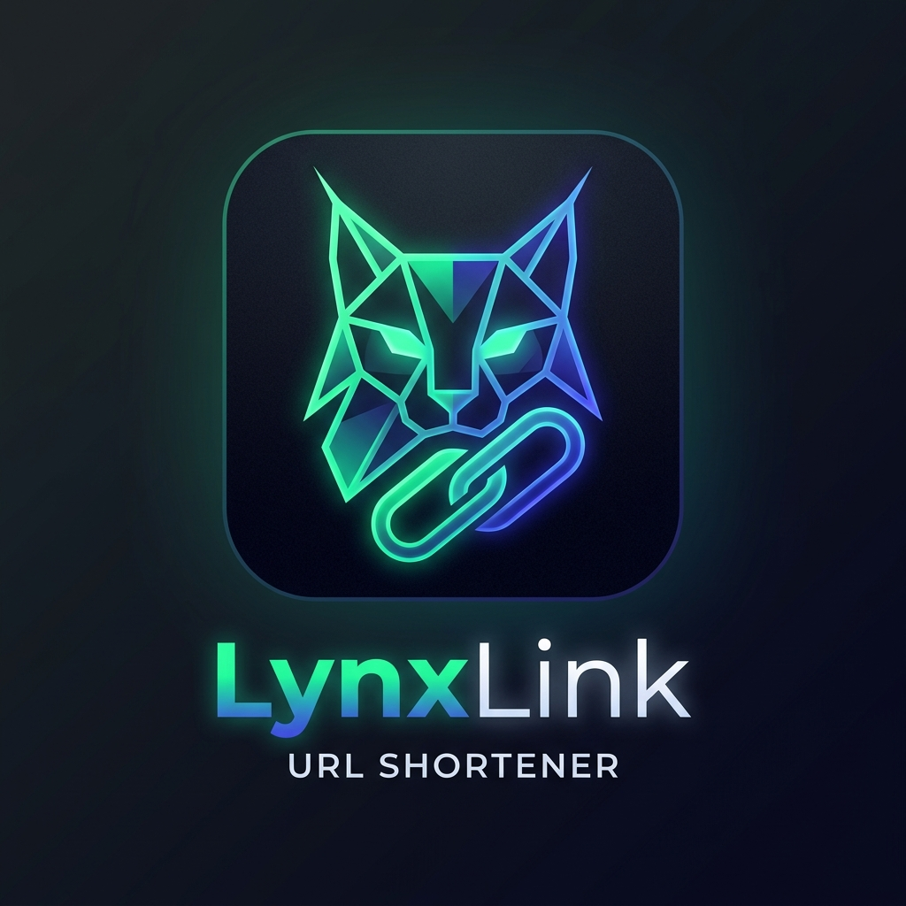

<div align="center">



# ⚡ LynxLink
### Next-Generation URL Intelligence & High-Velocity Redirect Engine

[](https://spring.io/projects/spring-boot)
[](https://neon.tech)
[](https://redis.io)
[](https://react.dev)
[](https://vitejs.dev)
[](https://tailwindcss.com)

<p align="center">
  <b>A distributed, high-performance URL shortening and click-stream analytics platform engineered with Spring Boot, Neon Cloud PostgreSQL, Redis, and React 19.</b>
</p>

[Key Features](#-core-features) • [Architecture](#-system-architecture) • [Database Configuration](#-cloud-database-neon-postgresql) • [Getting Started](#-getting-started) • [API Documentation](#-api-specification) • [Screenshots & UI](#-screenshots--ui-tour)

---

</div>

## 🌟 Executive Summary

**LynxLink** is an advanced full-stack software engineering project designed to solve the dual challenges of **ultra-low-latency web redirection** and **real-time analytics ingestion**.

While typical URL shorteners introduce database bottlenecks by recording analytics synchronously on every redirect, LynxLink implements an **asynchronous event-driven architecture**:
1. **Critical Path (<10ms)**: Redirections are resolved instantly via a Redis L1 in-memory cache and return an HTTP `302 Found` to the browser without blocking.
2. **Analytics Path (Async Pipeline)**: Click events, IP geographic metadata, operating system, and browser telemetry are queued to dedicated thread pool executors and persisted asynchronously into **Neon Serverless PostgreSQL**.

---

## 🚀 Core Features

### ⚡ Redirection & Performance Engine
- **Sub-10ms Global Latency**: Redis caching caches short codes with an automated 24-hour TTL and LRU eviction policy.
- **Fail-Safe Cache Miss Recovery**: Transparent fallback to Neon PostgreSQL if a short code is not present in cache, followed by automatic cache replenishment.
- **Asynchronous Telemetry Ingestion**: Uses Spring `@Async` thread pools to guarantee that recording telemetry never degrades user redirect speed.

### 📊 Real-Time Analytics & Click Intelligence
- **Deep Metrics**: Tracks aggregate clicks, unique daily visitors, time-series volume (30 days), browser distribution, and operating system breakdowns.
- **Interactive Visualizations**: Powered by Recharts with dynamic hover states, responsive layouts, and modern cyber-emerald aesthetics.
- **One-Click CSV Export (New)**: Export full dataset audit logs for all links or individual link analytics directly into standard CSV format for offline reporting and academic analysis.

### 🔗 Link Customization & Management
- **Custom Branded Aliases**: Generate custom vanity paths (e.g., `lynxlink/portfolio`) or auto-generated 8-character cryptographic hash strings.
- **Real-Time Search & Multi-Criteria Filtering (New)**: Instant keyword search across alias, destination URLs, and sorting by *Newest*, *Most Clicks*, *Alphabetical*, and *Oldest*.
- **Instant QR Code Generation**: Dynamically creates scannable, high-resolution QR codes accessible directly from the dashboard or through REST API with one-click PNG downloads.

### 🛡️ Enterprise Security & Reliability
- **Stateless JWT Authentication**: Secure user session management using JSON Web Tokens and BCrypt password encryption (12 rounds).
- **Sliding-Window Rate Limiting**: Redis-backed token bucket algorithm preventing URL spamming, malicious enumeration, and DoS attacks.
- **Flyway Database Migrations**: Automated schema version control from V1 to V6 ensuring zero-downtime database evolution.

---

## 🏗️ System Architecture

```
                                  ┌───────────────────────────────┐
                                  │      Client Applications      │
                                  │   (React 19 + Tailwind CSS)   │
                                  └──────────────┬────────────────┘
                                                 │
                                           REST  │  HTTP 302
                                                 ▼
┌─────────────────────────────────────────────────────────────────────────────────────────────────┐
│                                   LynxLink Spring Boot Engine                                    │
│                                                                                                 │
│  ┌───────────────────────┐    ┌───────────────────────────┐    ┌─────────────────────────────┐  │
│  │  Security & Auth      │    │  Redirect Controller      │    │  URL Management API         │  │
│  │  (JWT Filter + BCrypt)│    │  (GET /{shortCode})       │    │  (Create, List, Delete, QR) │  │
│  └───────────────────────┘    └─────────────┬─────────────┘    └──────────────┬──────────────┘  │
│                                             │                                 │                 │
│                          Cache Lookup /     │                                 │                 │
│                          Cache Aside        ▼                                 ▼                 │
│                          ┌────────────────────────────────────────────────────────┐             │
│                          │                 UrlService & CacheManager              │             │
│                          └──────┬──────────────────────────────────────────┬──────┘             │
│                                 │                                          │                    │
│                                 ▼                                          ▼                    │
│                 ┌──────────────────────────────┐           ┌────────────────────────────────┐   │
│                 │   L1: In-Memory Redis Cache  │           │   Async Telemetry Thread Pool  │   │
│                 │      (Key-Value String)      │           │     (@Async ClickEventWorker)  │   │
│                 └──────────────────────────────┘           └──────────────┬─────────────────┘   │
└───────────────────────────────────────────────────────────────────────────┼─────────────────────┘
                                                                            │
                                                     JDBC Connection Pool   │
                                                     (HikariCP SSL)         ▼
                                  ┌──────────────────────────────────────────────────┐
                                  │           Neon Serverless PostgreSQL             │
                                  │      (Users, ShortUrls, ClickEvents, Meta)       │
                                  └──────────────────────────────────────────────────┘
```

---

## 🗄️ Cloud Database (Neon PostgreSQL)

LynxLink is configured to utilize **Neon Serverless PostgreSQL** with built-in connection pooling for high concurrency and cloud resilience.

### Connection Parameters
| Configuration | Value |
|---|---|
| **Host** | `ep-sweet-dream-b5w1ctab-pooler.c-7.us-east-2.aws.neon.tech` |
| **Database** | `neondb` |
| **Port** | `5432` |
| **Username** | `neondb_owner` |
| **SSL Mode** | `require` |
| **Connection Pooling** | Enabled via PgBouncer |

### JDBC Connection String
```
jdbc:postgresql://ep-sweet-dream-b5w1ctab-pooler.c-7.us-east-2.aws.neon.tech/neondb?sslmode=require
```

### Database Schema Migrations (Flyway)
The backend automatically executes sequential Flyway migrations on application startup:
1. `V1__create_users_table.sql`: User credentials, authentication records, and creation timestamps.
2. `V2__create_short_urls_table.sql`: URL mapping, 8-character short codes, custom aliases, foreign keys.
3. `V3__create_click_events_table.sql`: Click telemetry, IP addresses, user agents, referrers, and timestamps.
4. `V4__create_url_metadata_table.sql`: OpenGraph metadata scraping and title caching.
5. `V5__increase_short_code_length.sql`: Extends short code indexing limits for large-scale alias storage.
6. `V6__remove_country_code_from_click_events.sql`: Streamlines event ingestion schema for optimized insert throughput.

---

## 🛠️ Technology Stack

| Layer | Technology | Version | Purpose |
|---|---|---|---|
| **Frontend** | React | 19.2.0 | Reactive component architecture & state |
| **Frontend Tooling** | Vite | 7.3.0 | Modern ESM bundler & Hot Module Reloading |
| **CSS Framework** | Tailwind CSS | 3.4.19 | Custom design system & responsive styling |
| **Motion & Icons** | Framer Motion & Lucide | 12.x / 0.56x | Smooth transitions & micro-interactions |
| **Charts** | Recharts | 3.7.0 | SVG-based responsive analytics charts |
| **Backend Framework** | Spring Boot | 3.4.x | REST API microservices & business logic |
| **Language** | Java | 21 (LTS) | Modern language features (virtual threads, records) |
| **Database** | Neon PostgreSQL | 16+ | Cloud relational persistence & ACID transactions |
| **Cache Store** | Redis | 7.x | L1 memory cache & sliding-window rate limiting |
| **Migration Tool** | Flyway | Latest | Automated database versioning and migrations |
| **Security** | Spring Security + JJWT | 0.12.x | Stateless JWT auth & BCrypt hashing |

---

## 🚦 Getting Started

### Prerequisites
- **Java Development Kit (JDK)**: Version 21 or higher
- **Node.js**: Version 18.0 or higher
- **Maven**: Version 3.8+ (or use included `./mvnw`)
- **Redis (Optional for local dev)**: Docker or local Redis service

---

### Option A: Quickstart with Local Environment

#### 1. Clone the Repository
```bash
git clone https://github.com/vineethGoudGithub/LynxLink.git
cd LynxLink
```

#### 2. Run the Spring Boot Backend
The backend is pre-configured with fallback defaults to the Neon PostgreSQL database:
```bash
cd backend
./mvnw spring-boot:run
```
> The API will be live on **http://localhost:8080** and health check is accessible at `http://localhost:8080/health`.

#### 3. Run the React Frontend
In a new terminal window:
```bash
cd frontend
npm install
npm run dev
```
> The web interface will open at **http://localhost:5173**.

---

### Option B: Run with Docker Compose
To run the full stack including Redis cache:
```bash
docker compose up --build
```

---

## 📡 API Specification

### Authentication Endpoints
| Method | Endpoint | Description | Auth Required |
|---|---|---|:---:|
| `POST` | `/api/auth/register` | Register a new user account | No |
| `POST` | `/api/auth/login` | Authenticate user and receive JWT bearer token | No |

### Link Operations
| Method | Endpoint | Description | Auth Required |
|---|---|---|:---:|
| `POST` | `/api/urls` | Create a new short URL with optional custom alias | Yes (JWT) |
| `GET` | `/api/urls` | Retrieve all shortened URLs created by current user | Yes (JWT) |
| `DELETE` | `/api/urls/{uuid}` | Delete a shortened URL and invalidate cache | Yes (JWT) |
| `GET` | `/api/urls/{shortCode}/analytics` | Retrieve detailed telemetry, timelines & breakdowns | Yes (JWT) |
| `GET` | `/api/urls/{shortCode}/qr` | Returns binary PNG stream of QR code | No |

### Public Redirection
| Method | Endpoint | Description | Auth Required |
|---|---|---|:---:|
| `GET` | `/{shortCode}` | Resolves short URL and returns HTTP 302 Found | No |
| `GET` | `/health` | Application health status and service metadata | No |

---

## 📄 License
This project is licensed under the MIT License - feel free to use and adapt it for academic, personal, or commercial purposes.
